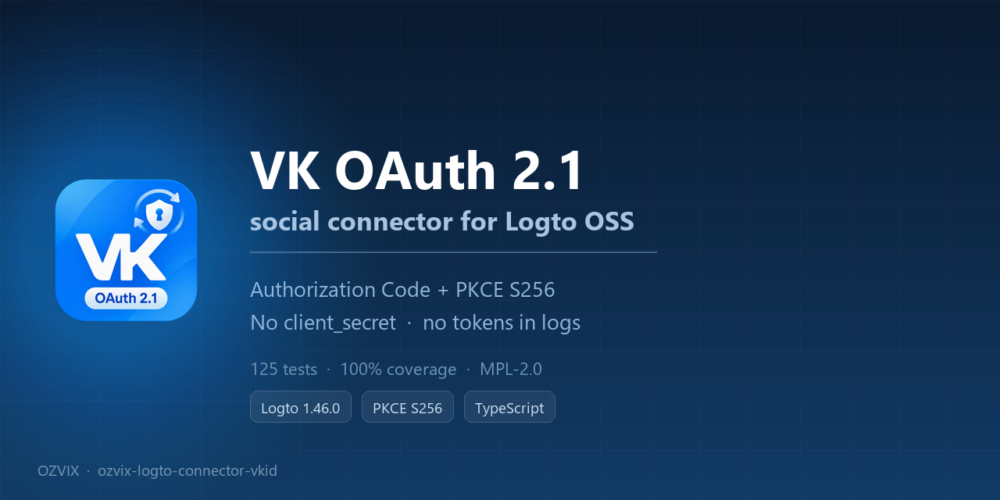
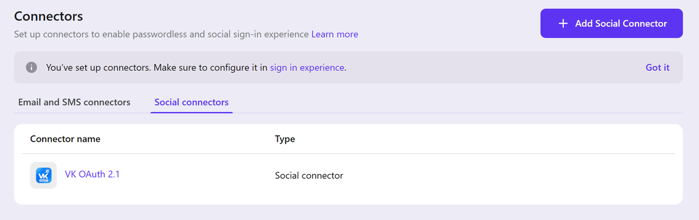
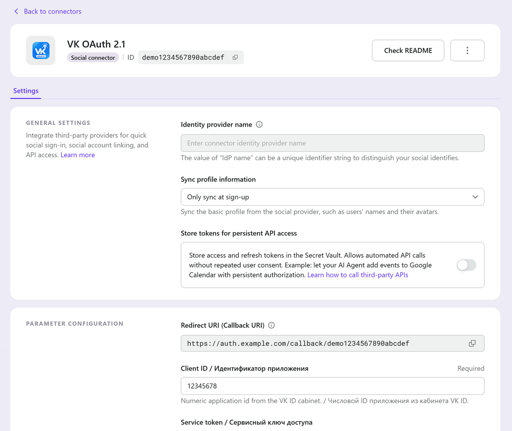

# ozvix-logto-connector-vkid

[](https://github.com/iPyotr/ozvix-logto-connector-vkid/actions/workflows/ci.yml)
[](LICENSE)
[](https://logto.io)
[](https://id.vk.ru/about/business/go/docs/ru/vkid/latest/vk-id/connection/realization)

<p align="center">
  
</p>

A social connector that adds **VK OAuth 2.1** sign-in to [Logto](https://logto.io) OSS.

VK ID here means the current VK authorization service (`id.vk.ru`, OAuth 2.1 authorization code
flow with PKCE `S256`) — **not** the legacy `oauth.vk.com` flow, which VK has deprecated and no
longer supports.

- Package: `@ozvix/connector-vkid` 1.1.0
- Connector factory id: `vk-universal`, target `vk`, type Social, platform Universal
- License: MPL-2.0
- Русская документация: [README.ru.md](README.ru.md)

## At a glance

|                         |                                                                                                                                                      |
| ----------------------- | ---------------------------------------------------------------------------------------------------------------------------------------------------- |
| **Protocol**            | VK OAuth 2.1 — authorization code + PKCE `S256`, no `client_secret`                                                                                  |
| **Logto**               | self-hosted OSS **1.46.0** (verified); other 1.x versions are untested                                                                               |
| **Endpoints**           | `id.vk.ru/authorize`, `/oauth2/auth`, `/oauth2/user_info` — nothing else                                                                             |
| **Profile**             | VK user id, display name (`first_name` + `last_name` + optional `patronymic`), avatar; e-mail/phone only when explicitly enabled                     |
| **Dependencies**        | `@logto/connector-kit`, `zod` — both already inside the Logto image                                                                                  |
| **Tests**               | 125 unit tests, 100 % coverage of `src/`, mock VK provider, Docker integration stack                                                                 |
| **Verified end-to-end** | against the real VK OAuth 2.1 service on 2026-11-10: authorize → consent → code exchange → `user_info` → Logto user created with the VK display name |

**Features**

- Hardened rewrite of `@workingbit/connector-vk@0.0.4` with a documented security audit
  ([22 findings](docs/SECURITY-AUDIT.md)).
- PKCE verifier, `redirect_uri` and `state` are bound to the Logto interaction session and replayed
  byte-identically; `state` is verified in the callback and in the token response.
- Tokens and the PKCE verifier never reach an error payload, a log line or a response body.
- `state` is raised to 46 characters in the derived image, matching VK's ≥ 32 requirement
  (stock Logto 1.46.0 generates 14).
- Opt-in e-mail/phone sync with validation and E.164 normalisation, avatars limited to absolute
  `http(s)` URLs, bounded and sanitised profile text.
- Works as a drop-in replacement for the upstream connector: the factory id `vk-universal` is kept,
  so an existing `connectorId` row keeps working.

## Screenshots

Demo values only: `auth.example.com` and `demo1234567890abcdef`.

<p align="center">
  
</p>

| Connector settings                                        | Sign-in experience                                                     |
| --------------------------------------------------------- | ---------------------------------------------------------------------- |
|  |  |

---

## Contents

- [Why this connector exists](#why-this-connector-exists)
- [Requirements](#requirements)
- [What the connector does](#what-the-connector-does)
- [Screenshots](#screenshots)
- [Security properties](#security-properties)
- [Quick start](#quick-start)
- [1. Register the redirect URI in VK ID](#1-register-the-redirect-uri-in-vk-id)
- [2. Configure the connector in Logto](#2-configure-the-connector-in-logto)
- [3. Enable VK ID in the sign-in experience](#3-enable-vk-id-in-the-sign-in-experience)
- [Configuration reference](#configuration-reference)
- [Account linking: why e-mail and phone sync are off by default](#account-linking-why-e-mail-and-phone-sync-are-off-by-default)
- [Limitations and known issues](#limitations-and-known-issues)
- [Troubleshooting](#troubleshooting)
- [Development](#development)
- [Documentation](#documentation)
- [License and provenance](#license-and-provenance)

---

## Why this connector exists

The published upstream package `@workingbit/connector-vk@0.0.4` **cannot be used as-is** with Logto
1.46.0, for two independently fatal reasons:

1. **Every real VK ID callback fails validation.** Its callback guard requires a `redirectUri`
   parameter in the callback. VK ID only sends `code`, `state`, `device_id` (and an optional
   `type`) — `redirect_uri` is a _request_ parameter, never a callback parameter. The guard
   therefore rejects every successful authorization.
2. **Logto 1.46.0 silently skips it.** The package pins `@logto/connector-kit` to the exact version
   `5.1.2`. Logto 1.46.0 ships `@logto/connector-kit` 5.2.0, and its connector loader refuses a
   package whose declared range does not satisfy the installed version. The connector never appears
   in the Admin Console.

On top of that, the upstream implementation requires a `clientSecret` that VK ID's token exchange
does not use (VK ID has no `client_secret` parameter at all), discards VK's `state` round-trip
check, and can serialise access/refresh tokens into error payloads that Logto writes to its log.

This connector is a hardened rewrite. Every finding is documented, with evidence, in
[SECURITY-AUDIT.md](docs/SECURITY-AUDIT.md); the architecture and the relationship to the upstream
code are in [ARCHITECTURE.md](docs/ARCHITECTURE.md).

## Requirements

| Requirement                   | Details                                                                                                                                                 |
| ----------------------------- | ------------------------------------------------------------------------------------------------------------------------------------------------------- |
| Logto OSS                     | **1.46.0 verified.** Other 1.x versions are UNVERIFIED — the loader's connector-kit version gate is version-specific.                                   |
| `@logto/connector-kit`        | **>= 5.2.0** (this package declares `^5.2.0`). An older kit fails Logto 1.46.0's version gate and the connector is skipped.                             |
| Node.js                       | >= 22 for building from source only (the official Logto image already ships a newer Node.js).                                                           |
| Docker                        | Docker Engine or Docker Desktop, if you use one of the container install paths.                                                                         |
| VK ID application             | Created in the VK ID cabinet, with a confirmed business profile and the exact redirect URI registered. See [VK-ID-SETUP.md](docs/VK-ID-SETUP.md).       |
| Public HTTPS host on port 443 | VK ID only supports ports 80 and 443 for redirect URIs, and production use is HTTPS. A Logto dev instance on `:3001` cannot be a VK ID redirect target. |

## What the connector does

- Authorization: OAuth 2.1 authorization code + PKCE (`S256`), `https://id.vk.ru/authorize`.
- Token exchange: `POST https://id.vk.ru/oauth2/auth` — no `client_secret`; confidential VK ID
  applications send `service_token` instead and must call from an allow-listed IP address.
- Profile: `POST https://id.vk.ru/oauth2/user_info?client_id=…` with the access token in the form
  body. The connector forwards:
  - the stable VK user id (used as the social identity subject),
  - the display name, built from `first_name`, `last_name` and (when present) `patronymic`,
  - the avatar URL, only if it is an absolute `http(s)` URL,
  - the e-mail and the phone number — **only** when `syncEmail` / `syncPhone` are enabled.
- Token storage: when Logto's token storage (Secret Vault) is enabled, the access token, refresh
  token, `id_token`, `expires_in`, `scope` and `token_type` are handed to Logto. The connector does
  **not** implement a refresh grant — see [Limitations](#limitations-and-known-issues).
- `isTokenStorageSupported: true`, `id: vk-universal`, `target: vk`, `platform: universal`.
- Supported VK account data comes from three scopes: `vkid.personal_info` (default: name, avatar,
  sex, birthday), `email`, `phone`. VK ID returns a value only if the scope is **both** enabled in
  the VK ID application dashboard **and** requested in the `scope` parameter; `phone` additionally
  requires a verified business profile.

## Security properties

- **PKCE verifier is server-side only.** A 256-bit verifier is minted per authorization request,
  stored in the Logto interaction session, and never appears in a URL, a log line or an error.
- **`redirect_uri` and `state` are persisted and replayed byte-identically** at the token endpoint.
  Logto generates `state` and its own client compares the value on the callback, but Logto core does
  **not** verify it server-side; the connector therefore binds the persisted value to the callback
  and to the token response itself (defence in depth) and fails on a non-empty mismatch.
- **Subject consistency.** The `user_id` in the token response is compared with the `user_id` in the
  profile; a mismatch fails with an "invalid access token" error instead of attaching the wrong
  identity.
- **No provider payloads in errors.** Errors carry an OAuth error code, an HTTP status and field
  names only. Access tokens, refresh tokens, `id_token`s, authorization codes and the PKCE verifier
  never appear in error data, and the connector's timeout error is deliberately shaped so Logto
  logs only the origin and path of the failing request.
- **Account-takeover guard rails.** `syncEmail` and `syncPhone` are off by default, because Logto
  links a social identity to an **existing** Logto user by e-mail or phone. Forwarding a
  provider-supplied, possibly unverified identifier would turn it into a cross-provider account
  takeover primitive. E-mail is validated and lower-cased, the phone number is normalised to E.164
  or dropped.
- **Bounded, sanitised profile text.** Names are capped, control characters, Unicode format/bidi
  characters and newlines are stripped, empty values are omitted rather than forwarded as `""`.
- **Hostile provider and callback input is neutralised.** `error` / `error_description` from a
  callback (fully attacker-controlled query parameters) and from VK ID error bodies are stripped of
  control characters and capped at 200 characters before they reach an error payload, so neither can
  forge log lines or flood the Logto log. The VK user id — the value Logto stores and displays as the
  social identity — must match `[A-Za-z0-9._:-]{1,64}` and is rejected otherwise instead of being
  normalised. Response bodies are capped at 1 MiB, and `apiBaseUrl` may not embed credentials.
- **Minimal egress.** The only network endpoints are VK ID's `authorize`, `oauth2/auth` and
  `oauth2/user_info`. No telemetry, no analytics, no update checks, no filesystem access, no
  environment reads. Runtime dependencies are `@logto/connector-kit` and `zod`, both already present
  in the Logto image, so installing the connector adds no new runtime package to the container.
- **Config validation.** `clientId` is required; `apiBaseUrl` must be an `http(s)` origin without a
  path, query or fragment and without embedded credentials — HTTPS is the documented default, and an
  explicit plain-HTTP origin is an administrator decision for LAN mirrors and integration tests;
  `timeout` is limited to 1000–60 000 ms.

## Quick start

Two install paths exist. Both put the built connector package into
`/etc/logto/packages/core/connectors/` inside the Logto container, where Logto 1.46.0 scans for
connectors **at runtime, on startup**.

The directory check Logto performs:

- the directory must contain a `package.json` whose `name` starts with `connector-` or
  `@scope/connector-*` — `@ozvix/connector-vkid` satisfies this;
- the package's `dependencies["@logto/connector-kit"]` range must satisfy the installed version
  (5.2.0) — `^5.2.0` satisfies it;
- the entry point is `lib/index.js` (this package's `main`).

The directory name itself is arbitrary — the loader keys off the `package.json` `name` field — and
this repository uses `connector-ozvix-vkid`. Copy the whole package directory (`package.json`,
`lib/`, and whatever assets the package ships: its own README and the logo files referenced by the
connector metadata), not only `lib/`.

### Path A — derived Docker image (recommended)

This repository ships a multi-stage [`Dockerfile`](Dockerfile) that builds the connector with Node.js
22 and copies it into the official image:

```bash
docker build -t ozvix/logto-vkid:1.46.0-vkid.1 .
```

Then point the Logto service in your compose file at `ozvix/logto-vkid:1.46.0-vkid.1` and recreate
the container. The image is immutable and reproducible, and because every update is a new tag,
rollback is a one-line change — which is why this is the recommended path for production.

### Path B — bind mount

Keep the official `svhd/logto:1.46.0` image and mount a host directory at the connector
**subdirectory only**:

```yaml
# docker-compose fragment — complete example in docs/INSTALL-LOGTO-DOCKER.md
services:
  logto:
    volumes:
      - /opt/logto/connectors/connector-ozvix-vkid:/etc/logto/packages/core/connectors/connector-ozvix-vkid:ro
```

Never mount `/etc/logto/packages/core/connectors` itself: that hides every official connector,
including whichever provider you keep as a fallback. The mount must exist **before** Logto starts,
because the directory is scanned on startup. This path is convenient when you cannot build images on
the host.

Exact commands for both paths — including backups, verification, upgrades and rollback — are in
**[INSTALL-LOGTO-DOCKER.md](docs/INSTALL-LOGTO-DOCKER.md)**.

After either path, check that the connector was loaded:

1. Admin Console → **Connectors** → **Social connectors** → **Add social connector**. "VK ID"
   should be selectable.
2. If it is not listed, the loader skipped it — see
   [TROUBLESHOOTING.md](docs/TROUBLESHOOTING.md#connector-is-not-listed-in-the-admin-console).

## 1. Register the redirect URI in VK ID

Full walkthrough, including the cabinet steps and the scope gating: **[VK-ID-SETUP.md](docs/VK-ID-SETUP.md)**.
The short version:

1. Create an application in the VK ID cabinet (https://id.vk.ru/about/business/go/). The cabinet is
   reached through a VK Бизнес ID account, and app keys/settings are restricted until the business
   profile is confirmed.
2. Set **Базовый домен** to the public host that serves Logto, for example `auth.example.com`.
3. Set **Доверенный redirect URL** to the **exact** callback URL of the connector:
   `https://auth.example.com/callback/<connector-id>`.

VK ID matches the redirect URI by exact string (the domain must equal the base domain), so copy the
**Callback URI** from the connector page in the Logto Admin Console rather than typing it by hand.
VK ID only accepts ports 80 and 443, so `:3001`/`:3002` development URLs cannot be registered.

## 2. Configure the connector in Logto

Admin Console → **Connectors** → **Social connectors** → **VK ID** → fill in:

| Field             | Value                                                                                                                                                        |
| ----------------- | ------------------------------------------------------------------------------------------------------------------------------------------------------------ |
| Client ID         | The numeric application id (`ID приложения`) from the VK ID cabinet.                                                                                         |
| Service token     | Leave empty for a normal public web application. Only for VK ID applications marked _Конфиденциальное_; those must also call from an allow-listed egress IP. |
| Scope             | `vkid.personal_info` unless you need more. Add `email` and/or `phone` only if they are enabled in the VK application.                                        |
| Sync e-mail       | Off unless you want Logto to receive the VK e-mail — read [Account linking](#account-linking-why-e-mail-and-phone-sync-are-off-by-default) first.            |
| Sync phone number | Off, same reasoning; Logto prefers a phone match over an e-mail match.                                                                                       |

There is no redirect-URI field: the connector always uses the callback URI Logto generated for it.
There is also **no `clientSecret` field** — VK ID's token exchange has no `client_secret`
parameter. Do not paste the VK application's _Защищённый ключ_ anywhere.

## 3. Enable VK ID in the sign-in experience

Admin Console → **Sign-in experience** → **Social sign-in** → add the VK ID connector, then save.
(This repository targets a social-only installation: registration and sign-in with e-mail and
password are disabled, and the VK profile supplies the display name and avatar, with e-mail/phone
only when synced.)

Before you switch to social-only, make sure at least one working social connector (for example
Yandex ID) remains available, so an administrator cannot be locked out.

## Configuration reference

Seven fields, all editable in the Admin Console. Only `clientId` is mandatory.

| Field          | Console type                  | Required | Default              | Description                                                                                                                                                                                                                                                                                                                                                      |
| -------------- | ----------------------------- | -------- | -------------------- | ---------------------------------------------------------------------------------------------------------------------------------------------------------------------------------------------------------------------------------------------------------------------------------------------------------------------------------------------------------------- |
| `clientId`     | text                          | **yes**  | —                    | VK ID application id (`ID приложения`), numeric. Sent as `client_id` on the authorize request, the token exchange and the `user_info` query.                                                                                                                                                                                                                     |
| `serviceToken` | text (stored as confidential) | no       | empty                | Only for VK ID applications marked _Конфиденциальное_ (`Сервисный ключ доступа`). Sent as the `service_token` POST parameter on the token exchange. Confidential applications must also call from an allow-listed IP address. Leave empty for a public web application. Never the _Защищённый ключ_.                                                             |
| `scope`        | multiline text                | no       | `vkid.personal_info` | Space-separated VK ID scopes. A value is returned only if the scope is enabled in the VK application **and** requested here.                                                                                                                                                                                                                                     |
| `syncEmail`    | switch                        | no       | `false`              | Forward the VK e-mail to Logto. Enabling it lets Logto link an existing e-mail account to this VK identity — see [Account linking](#account-linking-why-e-mail-and-phone-sync-are-off-by-default).                                                                                                                                                               |
| `syncPhone`    | switch                        | no       | `false`              | Forward the VK phone number (normalised to E.164) to Logto. Same caveat as `syncEmail`, and Logto prefers phone over e-mail when linking.                                                                                                                                                                                                                        |
| `apiBaseUrl`   | text                          | no       | `https://id.vk.ru`   | VK ID API origin override. Must be an origin with no path, query or fragment. HTTPS is the default; an explicit `http://` origin is accepted for LAN mirrors and integration tests, but over plain HTTP the access token, the authorization code and the PKCE verifier travel unencrypted. `https://id.vk.com` works too but redirects (HTTP 308) to `id.vk.ru`. |
| `timeout`      | number                        | no       | `8000`               | Timeout for the token and `user_info` requests, in milliseconds. Allowed range 1000–60 000.                                                                                                                                                                                                                                                                      |

Configuration validation is strict: an empty `clientId`, a non-URL `apiBaseUrl`, an origin with a
path/query/fragment or embedded credentials, a malformed scope token or an out-of-range timeout is
reported as an invalid configuration instead of failing later in the flow.

## Account linking: why e-mail and phone sync are off by default

Logto's social sign-in does more than authenticate: when a social identity arrives with an e-mail
or a phone number, Logto looks for an **existing** Logto user with that identifier and, if one
exists, attaches the VK identity to that account.

That is a convenience feature for providers that verify identifiers. It is a security hazard when
the identifier is not verified by the provider or is not verified the way you expect:

- If a VK ID account can carry an e-mail address that VK has not proven the user owns, forwarding
  it lets whoever controls that VK account log in as the owner of the matching Logto account.
- Logto prefers a **phone** match over an e-mail match, so `syncPhone` is the more dangerous switch
  of the two.
- An administrator's Logto account is an especially attractive target.

The connector therefore returns `email` and `phone` to Logto only when you enable `syncEmail` /
`syncPhone`. Even then, three conditions must all hold for a value to be present: the scope is
enabled in the VK ID application dashboard, the scope is included in the configured `scope`, and
the corresponding sync switch is on. Keep both switches off unless you specifically need the
identifier in Logto (for example to e-mail users from Logto) and you accept the linking behaviour.

## Limitations and known issues

| Limitation                                      | Details                                                                                                                                                                                                                                                                                                                                                                         |
| ----------------------------------------------- | ------------------------------------------------------------------------------------------------------------------------------------------------------------------------------------------------------------------------------------------------------------------------------------------------------------------------------------------------------------------------------- |
| No refresh-token flow                           | VK ID access tokens live **1 hour**; refresh tokens live **180 days** but are single-use with rotation (reusing an old one invalidates the session), and VK's refresh grant also needs the `device_id`, which is not persisted. The connector forwards the refresh token to Logto's token storage but never refreshes it, so a stored access token becomes stale after ~1 hour. |
| Token storage is "store, no refresh"            | `isTokenStorageSupported` is `true`; Logto stores what the token exchange returned. Treat it as an audit/one-hour-use capability, not as long-lived delegated access.                                                                                                                                                                                                           |
| Ports 80/443 only                               | VK ID only supports redirect URIs on ports 80 and 443. A development Logto on `:3001` cannot be a VK ID redirect target; use a public HTTPS host on 443 (the production path) or a local HTTPS endpoint on 443.                                                                                                                                                                 |
| `state` length                                  | VK OAuth 2.1 requires `state` of at least 32 characters, and the official VK SDKs enforce that minimum. Stock Logto 1.46.0 generates 14, so the derived image patches the pinned Experience bundle to 46 characters at build time (and fails if the patch cannot be applied). See [TROUBLESHOOTING.md](docs/TROUBLESHOOTING.md).                                                |
| `id_token` is not validated                     | VK ID is OAuth 2.1 with a proprietary JWT, not OpenID Connect: there is no discovery document, no JWKS and no `iss`/`aud` claims. Identity comes from `user_info` over TLS with a token obtained directly from VK ID; the JWT is never used as a trust anchor.                                                                                                                  |
| No logout / revocation propagation              | Signing out of Logto does not revoke the VK ID session, and permissions revoked in VK are only noticed at the next sign-in.                                                                                                                                                                                                                                                     |
| Callback error contract is undocumented         | VK ID documents that a failed authorization shows the user an error page, but not whether an `error` parameter is redirected back. The connector handles both (an `error` callback becomes an authorization failure, a callback without `code` becomes a generic authorization failure) but cannot guarantee a friendly message.                                                |
| Token-endpoint error codes are not standardised | VK ID documents only that a malformed token request answers `404 NOT FOUND`. Any 4xx from the token endpoint is therefore reported as an invalid authorization code; there is no branching on specific error strings.                                                                                                                                                           |
| Rate limits                                     | Public VK ID applications are limited to **15 000 requests/day per IP**; confidential ones to **120 000/day per application** (and require a static, allow-listed egress IP).                                                                                                                                                                                                   |
| Logto version support                           | Verified against self-hosted Logto OSS 1.46.0 only. Other Logto versions and hosted Logto Cloud are UNVERIFIED — this connector is built for self-hosted Logto OSS.                                                                                                                                                                                                             |
| `verified` is ignored                           | VK's account-verification flag (the grey check mark) says nothing about e-mail ownership, so it is not mapped to anything in Logto.                                                                                                                                                                                                                                             |

## Troubleshooting

Start with **[TROUBLESHOOTING.md](docs/TROUBLESHOOTING.md)**: a symptom → cause → fix table plus
"how to read the Logto logs" and "how to roll back" sections. The three most common causes:

1. The connector is missing from the Admin Console — the loader skipped the directory (name, entry
   point or connector-kit version gate). Check the Logto container log for `[load-connector]`.
2. VK ID shows an error page after the consent screen — the registered **Доверенный redirect URL**
   does not match the callback URI exactly, or it uses a port other than 80/443.
3. No e-mail or phone in the Logto user — `syncEmail`/`syncPhone` are off by default, and the scope
   must be enabled in the VK application as well.

## Development

```bash
npm ci            # install dependencies (Node.js >= 22)
npm run build     # tsup → lib/index.js (ESM bundle)
npm run check     # tsc --noEmit
npm run lint      # eslint
npm test          # vitest unit suite
npm run verify    # check + lint + test + build
```

`npm test` runs the unit suite under `tests/`; it does not contact VK ID or Logto. The local
container integration environment (Logto 1.46.0 + PostgreSQL + a mock VK ID server) and its exact
commands are documented in [LOCAL-TESTING.md](docs/LOCAL-TESTING.md).

A **real end-to-end VK ID login is a manual step**: it requires a registered VK ID application, a
port-443 redirect URI and real VK credentials. The checklist — which explicitly has not been
executed by the project — is the **Manual verification checklist** section of
[VK-ID-SETUP.md](docs/VK-ID-SETUP.md#manual-verification-checklist).

## Documentation

| Document                                                          | Contents                                                                                                                                                      |
| ----------------------------------------------------------------- | ------------------------------------------------------------------------------------------------------------------------------------------------------------- |
| [CONNECTOR.md](CONNECTOR.md)                                      | The setup guide rendered inside the Logto Admin Console: English and Russian sections, VK ID cabinet steps, configuration reference, scopes, troubleshooting. |
| [SECURITY.md](SECURITY.md)                                        | Supported versions, private vulnerability reporting, in-scope and out-of-scope issues.                                                                        |
| [CONTRIBUTING.md](CONTRIBUTING.md)                                | Development setup, style rules, tests, review and licensing expectations.                                                                                     |
| [VK-ID-SETUP.md](docs/VK-ID-SETUP.md)                             | Creating the VK ID application, redirect URI rules, scopes, manual end-to-end checklist, revoking credentials.                                                |
| [TROUBLESHOOTING.md](docs/TROUBLESHOOTING.md)                     | Symptom → cause → fix table, reading logs, rolling back.                                                                                                      |
| [INSTALL-LOGTO-DOCKER.md](docs/INSTALL-LOGTO-DOCKER.md)           | Both Docker install paths, complete commands, upgrades.                                                                                                       |
| [IMPLEMENTATION.md](docs/IMPLEMENTATION.md)                       | End-to-end implementation: VK application, derived image, deployment, connector setup, verification, operations.                                              |
| [LOCAL-TESTING.md](docs/LOCAL-TESTING.md)                         | Local Logto + mock VK ID environment, how to run it and what it does and does not prove.                                                                      |
| [ARCHITECTURE.md](docs/ARCHITECTURE.md)                           | How the connector works, the request flow, relationship to the upstream package.                                                                              |
| [SECURITY-AUDIT.md](docs/SECURITY-AUDIT.md)                       | The audit of the upstream package, findings F-01…F-22, provenance, licensing, residual risks.                                                                 |
| [research/VK-ID-PROTOCOL.md](docs/research/VK-ID-PROTOCOL.md)     | Verified VK ID protocol reference with primary-source quotes.                                                                                                 |
| [research/LOGTO-146-COMPAT.md](docs/research/LOGTO-146-COMPAT.md) | Logto 1.46.0 compatibility research: connector-kit API, session API, loader mechanics.                                                                        |
| [PUBLISHING.md](docs/PUBLISHING.md)                               | Publishing checklist: GitHub, description, topics, release, npm, Docker image, repository settings.                                                           |
| [README.ru.md](README.ru.md)                                      | Русская версия этого документа.                                                                                                                               |

## License and provenance

This project is licensed under the **Mozilla Public License 2.0** — see [LICENSE](LICENSE).
It is a derivative work, not an original connector:

`@workingbit/connector-vk@0.0.4` → `lynx-r/logto-connector-vk` → Logto's `connector-github`
(`logto-io/logto`, MPL-2.0).

The provenance chain, the upstream integrity hash and the list of files whose content was carried
over are recorded in [NOTICE](NOTICE) and in
[SECURITY-AUDIT.md § 4](docs/SECURITY-AUDIT.md#4-licensing). The project is not affiliated with,
endorsed by, or sponsored by VK or Logto; VK ID and the VK name are trademarks of their respective
owners. The connector icon (`logo.png` / `logo-dark.png`) contains the VK wordmark and is used
nominatively to identify the sign-in provider; it does not imply endorsement by VK. The icon is not
part of the executable bundle and can be replaced with neutral artwork without affecting behaviour.
